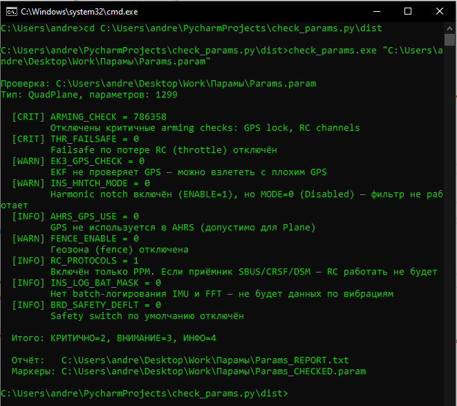

# 📡🐝 ArduPilot Parameter Checker

A utility for quickly checking the configuration of ArduPilot-based drones (Plane, Copter, and QuadPlane) before takeoff.

The script identifies critical errors that could prevent the drone from taking off or cause a crash, as well as suspicious settings that could affect flight safety.

---

> **Note:** The architecture and check rules were developed based on a real prototype using a Cube flight controller running ArduPilot QuadPlane firmware. AI assistance was used to speed up routine coding tasks, while the check logic, testing, and validation were performed independently.

## 🚀 Features

- **Automatic device type detection:** Automatically determines whether the vehicle is a Plane, Copter, or QuadPlane by analyzing the parameter dump.
- **Deep Analysis:** Checks arming, failsafe, battery, EKF, fence, motors, RC, and vibration settings.
- **Report Generation:** Creates a `<filename>_REPORT.txt` file with detailed explanations of detected issues.
- **Parameter Marking:** Creates a `<filename>_CHECKED.param` file with markers indicating the severity of detected issues:
  - `!!!` — Critical issue
  - `!` — Warning
  - `i` — Informational message
- **HTML Support:** The `--html` flag generates a colorized report that can be viewed in a web browser.

## 🛠 Installation and Run (from Source)

### Requirements

- Python 3.8 or newer

### Clone the repository

```bash
git clone https://github.com/Andrey7522/Ardupilot-param-checker.git
cd Ardupilot-param-checker
```

### Run the script

```bash
python check_params.py "path/to/Params.param"
```

To generate an HTML report, use the `--html` flag:

```bash
python check_params.py --html "path/to/Params.param"
```

## 📦 Building EXE for Windows

### 1. Install PyInstaller

```bash
pip install pyinstaller
```

### 2. Build the executable

Run the following command from the project directory:

```bash
pyinstaller --onefile check_params.py
```

The executable will be created at:

```text
dist/check_params.exe
```

### 3. Run the executable

```cmd
check_params.exe "C:\Users\andre\Desktop\Work\Params.param"
```

If running from the project directory, use the full path to the executable:

```cmd
dist\check_params.exe "C:\Users\andre\Desktop\Work\Params.param"
```

## 📸 Example of Work

<p align="center">
  
</p>


## 👨‍💻 Author:  
Andrey Chebotarev
